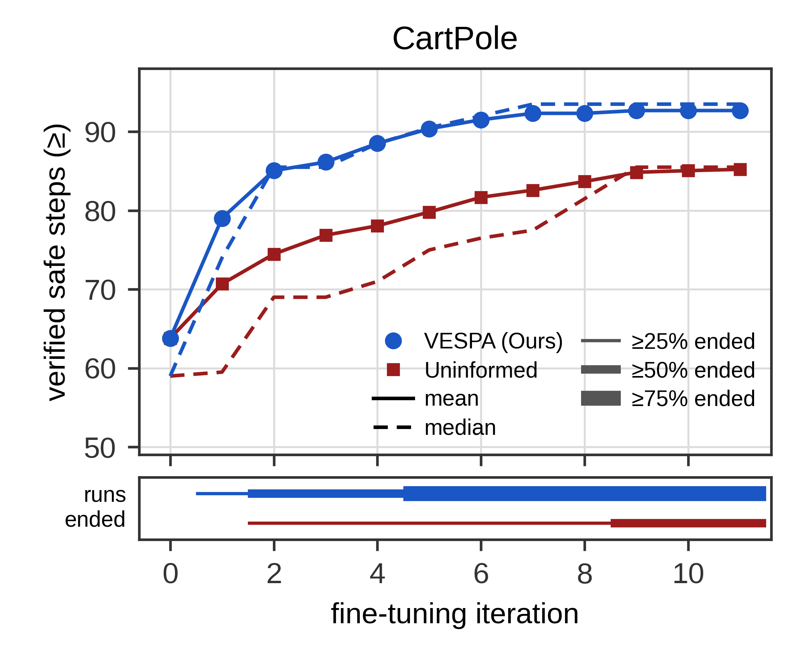
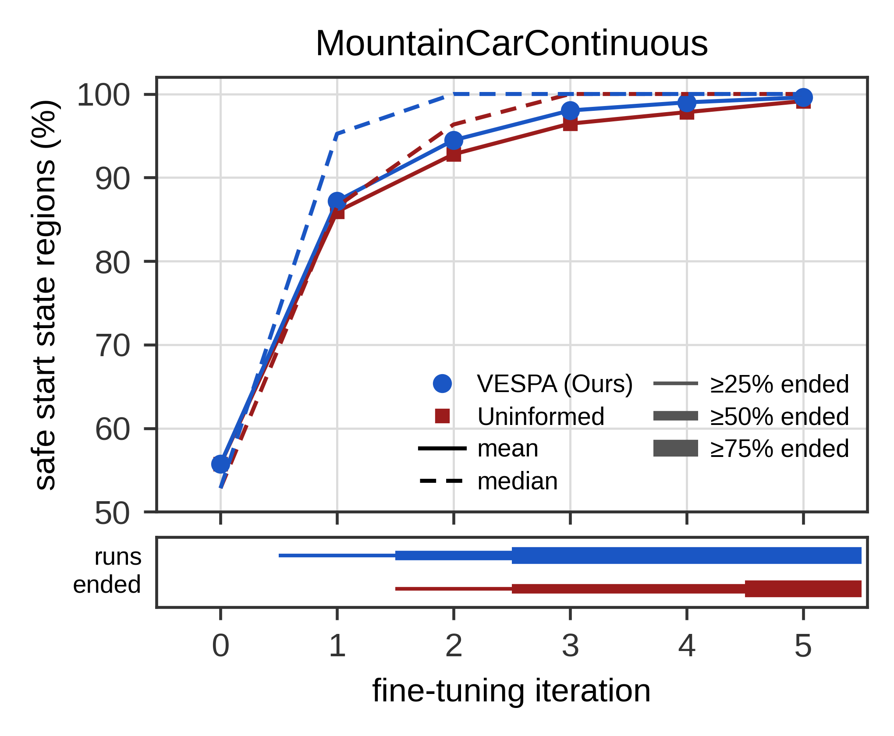

# VESPA: Verifiable Symbolic Policy Adaptation for Safe Reinforcement Learning

Paul König, Sascha Marton, Stefan Lüdtke, Christian Bartelt

VESPA uses the result of a formal verification as a training signal for targeted fine-tuning. It verifies a decision tree policy with reachability analysis, extracts counterexample regions from the violating states, fine-tunes the policy with episodes that start in those regions, and verifies the fine-tuned policy again. The loop repeats until the policy is proven safe or the iteration budget is used up.

<p align="center">
  
  
</p>

## Repository layout

```
src/vespa/sympol.py        the decision tree policy (SYMPOL)
src/vespa/cartpole/        CartPole: box verifier, counterexample regions, fine-tuning, loop
src/vespa/mountaincar/     MountainCarContinuous: zonotope verifier, counterexample regions, fine-tuning, loop
src/vespa/pretraining/     training and pruning of the input policies
experiments/               one command per run and one driver per table, for each environment
analysis/                  from run directories to the tables and figures of the paper
policies/                  pretrained input policies (SYMPOL trees for both environments, VIPER trees)
baselines/viper/           how the VIPER trees were produced and converted
environment/               pinned software environment
tests/                     CPU tests
```

Each directory has a README with the details. The settings of the paper are fixed in
`experiments/cartpole/config.toml` and `src/vespa/mountaincar/config.py`.

## Installation

```bash
conda env create -f environment/environment.yml    # Python 3.11, JAX 0.9.2 (CUDA 12), pinned versions
conda activate vespa
pip install -e . --no-deps
```

All commands are run from the repository root. Every run needs one NVIDIA GPU. The tests and the analysis run on CPU.

## Reproducing the paper

### 1. Run the experiments

| Paper result | Command | Runs | GPU used in the paper |
|---|---|---|---|
| CartPole results table and progress figure | `python experiments/cartpole/runs.py run --table tab_cp` | 96 | NVIDIA H200 |
| Verified safe steps of the VIPER trees | `python experiments/cartpole/runs.py run --table viper` | 21 | NVIDIA H200 |
| Verified safe steps of the SYMPOL trees in the return-vs-safety figure | `python experiments/cartpole/runs.py run --table figure3` | 3 | NVIDIA H200 |
| MountainCarContinuous results table and progress figure | `python experiments/mountaincar/run_all.py` | 120 | NVIDIA RTX PRO 6000 |

The runs are independent of each other. `runs.py run-index --table tab_cp --index I` and `run_all.py --index I` run a single one, for example as one task of an array job (`experiments/slurm/`). Finished runs are skipped when run again.

A single run specified by one input policy, the method and one fine-tuning seed:

```bash
python experiments/cartpole/run.py loop --policy s13u --method vespa --seed 0
python experiments/cartpole/run.py loop --policy s13u --method uninformed --seed 0
python experiments/cartpole/run.py verify --policy viper_L8_s4          # verification only

python -m vespa.mountaincar.run --policy policies/mountaincar/evaluation/s0/base-pruned \
    --method vespa --seed 100000 --run-name s0-pruned-vespa-k1
python -m vespa.mountaincar.verify --policy policies/mountaincar/evaluation/s0/base    # verification only
```

Runs write to `runs/cartpole/<run-name>/` and `runs/mountaincar/<run-name>/`.

### 2. Build the tables and figures

```bash
analysis/run_all.sh results
```

This reads `runs/cartpole` and `runs/mountaincar` and writes the three result tables (LaTeX and CSV) to
`results/tables/` and the three data figures to `results/figures/`. `analysis/README.md` lists every output file.

### 3. Optional: retrain the input policies

The input policies of the paper are in `policies/`, so this step is not needed to reproduce the results.
`experiments/pretraining/README.md` gives the commands that trained them.

## Tests

```bash
export JAX_PLATFORMS=cpu
for t in tests/*/test_*.py; do python $t || break; done
```

## Citation

```bibtex
@misc{koenig2026vespa,
  title  = {{VESPA}: Verifiable Symbolic Policy Adaptation for Safe Reinforcement Learning},
  author = {K{\"o}nig, Paul and Marton, Sascha and L{\"u}dtke, Stefan and Bartelt, Christian},
  year   = {2026}
}
```

## Authors

* Paul König: COgnitive SoftwaRE (CORE) @ Clausthal University of Technology
* Sascha Marton: COgnitive SoftwaRE (CORE) @ Clausthal University of Technology
* Stefan Lüdtke: Institute for Visual and Analytic Computing, University of Rostock
* Christian Bartelt: COgnitive SoftwaRE (CORE) @ Clausthal University of Technology

## License and acknowledgements

The code is released under the MIT License (see `LICENSE`).
